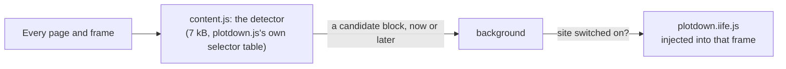

# plotdown for your browser

A browser extension (Chrome, Edge, Firefox) and a userscript that render fenced `plot`, `oplot` and `observable-plot` blocks of strict JSON as [Observable Plot](https://observablehq.com/plot/) charts on the pages you read: GitHub issues, pull requests, READMEs and gists, GitLab (gitlab.com and self-hosted), Bitbucket, Gitea, Forgejo and Codeberg, Azure DevOps, AI chats, and any page that shows Markdown code blocks.

It is `plotdown.js`, the script a site owner adds with one line, put in the page by your browser instead. It holds nothing specific to a site: where blocks are is known by `plotdown.js` itself (its selector table).

## How it works



- **The detector** (`src/detector.ts`, built into `content.js`) runs in every page and frame. It calls `findBlocks` with `SELECTORS`, bundled from the source of `plotdown.js` (`packages/plotdown/src/browser/selectors.ts`), so the two cannot drift apart. A page that has a candidate block, now or later (a streamed chat answer, content loaded on scroll: a `MutationObserver` searches the elements the page adds), sends one message and stops watching. A GitHub gnuplot block, whose markup is that of a `plot` block, counts only if its text starts like JSON; blocks in editors, and blocks a copy of `plotdown.js` on the page already claimed, do not count.
- **The background** checks the switches, then injects `plotdown.iife.js` into that frame (`scripting.executeScript`), after setting its options: remote data stays off, whatever the page says. Other pages never receive `plotdown.js`.
- **`plotdown.iife.js`** is copied from `packages/plotdown/dist` at build time; stores forbid code loaded from a CDN. A new `plotdown.js` reaches readers with an update of the extension.
- **The switches**: the popup has one for the current site (by host name) and one for all sites; both are kept in `storage.local`, and a change reloads the tab. Nothing leaves the browser: no request, no analytics.

Charts are drawn in a shadow root, with constructed style sheets, so a page whose Content-Security-Policy refuses `<style>` elements still styles them. Firefox accepts constructed style sheets from content scripts since version 153 ([bug 1751346](https://bugzilla.mozilla.org/show_bug.cgi?id=1751346)), the minimum version of the Firefox add-on.

## Build

```sh
pnpm install
pnpm build          # at the root: plotdown first, then this package
```

`pnpm --filter plotdown-extension build` writes:

| Output | What |
| --- | --- |
| `dist/chrome/` | the unpacked extension for Chrome and Edge (Manifest V3, service worker) |
| `dist/firefox/` | the unpacked extension for Firefox (event page, gecko id, no data collection) |
| `dist/plotdown.user.js` | the userscript |

`node build.mjs --sites=known` builds the known-hosts variant into `dist/chrome-known/` and `dist/firefox-known/` (see [Access to all sites](#access-to-all-sites)). `pnpm --filter plotdown-extension pack` zips what was built for the stores into `dist/stores/` (see [`store/readme.md`](store/readme.md)).

## Install it unpacked

- **Chrome or Edge**: open `chrome://extensions` (or `edge://extensions`), turn on developer mode, **Load unpacked**, pick `packages/extension/dist/chrome`.
- **Firefox**: open `about:debugging#/runtime/this-firefox`, **Load Temporary Add-on**, pick `packages/extension/dist/firefox/manifest.json`. Or `npx web-ext run -s packages/extension/dist/firefox`.

## The userscript

`dist/plotdown.user.js` is `plotdown.js` under a userscript header (`@match *://*/*`, `@grant none`), for Tampermonkey, Violentmonkey or Greasemonkey: open the file in the browser, or paste it into a new script. The same detector runs first, and `plotdown.js` is wrapped in a function it calls only when the page has a block: other pages parse the file but never run it. It has no switches: the manager's own per-site exclusions do that. It has no `@updateURL` yet; one can point to the file once it is published (for example on jsDelivr with the npm package).

## Access to all sites

The default build asks for access to all sites (`http://*/*`, `https://*/*`): that is what makes self-hosted GitLab or Gitea and any page work without setup, and the browser shows its broad-permission warning at install. If that puts a store or readers off, the known-hosts variant (`--sites=known`) lists only github.com, gist.github.com, gitlab.com, bitbucket.org, codeberg.org, gitea.com, dev.azure.com, chatgpt.com, claude.ai and gemini.google.com (`KNOWN_HOSTS` in `manifest.mjs`), with every other site as an optional permission: on such a site, the popup shows **Allow on _site_**, the browser asks, and the background registers the detector there (`scripting.registerContentScripts`). `plotdown.js` is the same in both.

## Tests

| Command | What | Where it runs |
| --- | --- | --- |
| `pnpm test` | the detector against the markup samples of `plotdown.js`, the switches, the manifests, the content script's size, the userscript wrapper (Vitest, jsdom) | CI, every push |
| `pnpm test:browser` | the extension loaded unpacked in Chromium: live github.com (`plot` and `oplot` blocks of the repository; a real gnuplot block on `rigtorp/c2clat`), local pages with GitHub's markup under a strict CSP, a page without a block, a block added later, a streamed block, the per-site and global switches; then the userscript | by hand: needs a browser and the network |
| `pnpm test:firefox` | the Firefox build as a temporary add-on, over WebDriver BiDi: live github.com and the strict-CSP page, with styles | by hand: needs Firefox (`PLOTDOWN_FIREFOX=<path>`) |
| `pnpm test:known` | the known-hosts variant: github.com renders, another host gets nothing | by hand |

The browser tests use Playwright's Chromium when it is installed, else the installed Edge, else Chrome (`PLOTDOWN_BROWSER=chromium|msedge|chrome`). Recent branded Chrome ignores `--load-extension`; Edge 156 still honours it. `PLOTDOWN_OFFLINE=1` skips the live pages, and `PLOTDOWN_STORE_IMAGES=1` writes the store screenshot. Screenshots of each test go to `test/browser/results` (not committed).

`pnpm icons` draws the PNG icons and the store's promotional images from `icons/icon.svg` with Playwright; they are committed, so the build needs no browser.

plotdown is not affiliated with Observable, Inc.
