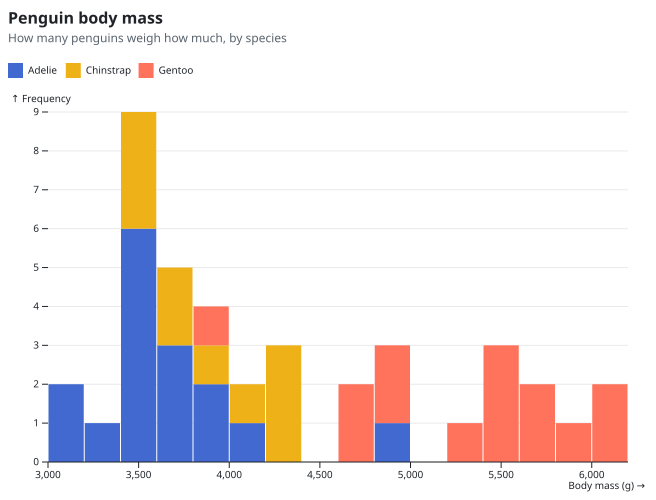
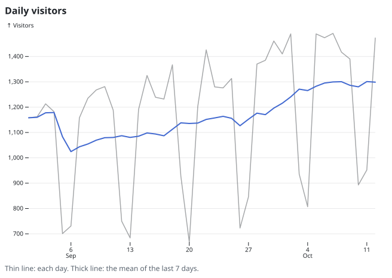
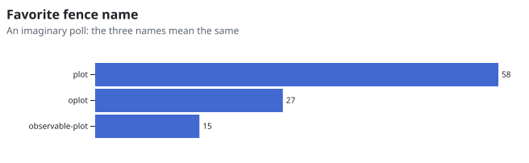

# plotdown

[](https://github.com/devlooped/plotdown/blob/main/license.txt)
[](https://github.com/devlooped/plotdown/actions/workflows/build.yml)

<!-- #content -->
Charts in Markdown, written as data. A fenced `plot` block holds the options of [Observable Plot](https://observablehq.com/plot/)'s `Plot.plot()` as strict JSON, and plotdown draws the chart: on GitHub and GitLab as an SVG image next to the block, on your site with one script tag, in your docs tool, editor or chat app with a plugin. Try it in the [playground](https://plotdown.cc/playground/); every setup has a recipe at [plotdown.cc](https://plotdown.cc/recipes/).

```plot
{
  "title": "Penguin body mass",
  "subtitle": "How many penguins weigh how much, by species",
  "data": {"penguins": {"csv": "species,body_mass_g\nAdelie,3400\nAdelie,3600\nAdelie,3450\nAdelie,3600\nAdelie,3000\nAdelie,3550\nAdelie,3900\nAdelie,3500\nAdelie,4850\nAdelie,4150\nAdelie,3450\nAdelie,3100\nAdelie,3300\nAdelie,3550\nAdelie,3700\nAdelie,3950\nChinstrap,4300\nChinstrap,3850\nChinstrap,4250\nChinstrap,3500\nChinstrap,3650\nChinstrap,4250\nChinstrap,3550\nChinstrap,4150\nChinstrap,3550\nChinstrap,3650\nGentoo,5300\nGentoo,5650\nGentoo,5700\nGentoo,6050\nGentoo,5550\nGentoo,4900\nGentoo,4700\nGentoo,5800\nGentoo,3850\nGentoo,4600\nGentoo,6100\nGentoo,4800\nGentoo,5500\nGentoo,5500\n"}},
  "color": {"legend": true},
  "x": {"label": "Body mass (g)"},
  "y": {"grid": true},
  "marks": [
    {"mark": "rectY", "data": "penguins", "x": "body_mass_g", "fill": "species",
     "transform": [{"binX": {"y": "count", "thresholds": 12}}]},
    {"mark": "ruleY", "data": [0]}
  ]
}
```
 <!-- plot:7c4cd4 -->

The chart above is that block, rendered by the [plotdown GitHub Action](#github-action) of this repository. The block stays in the file: on a surface that runs plotdown it becomes the chart, and everywhere else it is readable JSON with an image after it.

## The block

A block is the JSON form of a `Plot.plot()` call, with marks and transforms written as data instead of function calls:

````markdown
```plot
{
  "color": {"legend": true},
  "marks": [
    {"mark": "rectY", "data": "penguins", "x": "body_mass_g", "fill": "species",
     "transform": [{"binX": {"y": "count"}}]},
    {"mark": "ruleY", "data": [0]}
  ]
}
```
````

is

```js
Plot.plot({
  color: {legend: true},
  marks: [
    Plot.rectY(penguins, Plot.binX({y: "count"}, {x: "body_mass_g", fill: "species"})),
    Plot.ruleY([0])
  ]
})
```

| In Plot | In a block |
| --- | --- |
| `Plot.dot(data, {x: "a", y: "b"})` | `{"mark": "dot", "data": …, "x": "a", "y": "b"}` |
| `Plot.binX({y: "count"}, options)` | `"transform": [{"binX": {"y": "count"}}]`, innermost first |
| Data | Inline rows, CSV or TSV text, or a dataset named in the top-level `"data"` |
| Dates | ISO 8601 strings, such as `"2026-09-01"` |
| Functions, custom marks, DOM nodes | Not allowed: a block is data, so it is safe to render text written by anyone, or by a model |

The fence is `plot`, `oplot` or `observable-plot`: GitHub colors `plot` as gnuplot, the two others stay plain. A block may also live in a file of its own, named `*.plotdown.json`. Every option, mark and transform is in the [spec](spec/spec.md), and the JSON Schema, `https://plotdown.cc/schema/plot.schema.json` (the current version; `https://plotdown.cc/schema/0.1/plot.schema.json` for spec 0.1), validates a block in editors and in the structured outputs of language models.

```plot
{
  "title": "Daily visitors",
  "caption": "Thin line: each day. Thick line: the mean of the last 7 days.",
  "data": {"visits": {"csv": "date,visitors\n2026-09-01,1158\n2026-09-02,1162\n2026-09-03,1213\n2026-09-04,1182\n2026-09-05,701\n2026-09-06,731\n2026-09-07,1158\n2026-09-08,1235\n2026-09-09,1268\n2026-09-10,1281\n2026-09-11,1188\n2026-09-12,750\n2026-09-13,684\n2026-09-14,1191\n2026-09-15,1325\n2026-09-16,1239\n2026-09-17,1232\n2026-09-18,1367\n2026-09-19,928\n2026-09-20,667\n2026-09-21,1202\n2026-09-22,1426\n2026-09-23,1280\n2026-09-24,1276\n2026-09-25,1313\n2026-09-26,723\n2026-09-27,846\n2026-09-28,1370\n2026-09-29,1385\n2026-09-30,1461\n2026-10-01,1410\n2026-10-02,1489\n2026-10-03,936\n2026-10-04,807\n2026-10-05,1489\n2026-10-06,1474\n2026-10-07,1491\n2026-10-08,1417\n2026-10-09,1390\n2026-10-10,893\n2026-10-11,952\n2026-10-12,1473\n"}},
  "y": {"grid": true, "label": "Visitors"},
  "marks": [
    {"mark": "lineY", "data": "visits", "x": "date", "y": "visitors", "strokeOpacity": 0.4},
    {"mark": "lineY", "data": "visits", "x": "date", "y": "visitors", "stroke": "#4269d0", "strokeWidth": 2,
     "transform": [{"windowY": {"k": 7, "reduce": "mean", "anchor": "end"}}]}
  ]
}
```
 <!-- plot:c924b0 -->

## Where it renders

| Surface | How | Status |
| --- | --- | --- |
| GitHub, GitLab, Bitbucket, Azure DevOps, npm: anything that shows Markdown images | An SVG per block, committed next to the docs by the [CLI](#cli), the [GitHub Action](#github-action) or [GitLab CI](https://plotdown.cc/recipes/gitlab-ci/) | Available |
| Issue comments, Slack, Discord, email | [Image links](https://plotdown.cc/recipes/image-links/) from `plotdown.cc`: the playground's **Copy image link**, `plotdown link` | Available |
| Web pages, GitHub Pages, Hugo, MkDocs, Gitea, live with tooltips | `plotdown.js`, [one script tag](https://plotdown.cc/recipes/script-tag/) | Available |
| VitePress, Docusaurus, Astro, React and Streamdown chat UIs | [markdown-it, rehype, marked and React adapters](https://plotdown.cc/recipes/) | Available |
| Your own pages, apps and servers | The [`@devlooped/plotdown`](packages/plotdown) library | Available |
| Claude, ChatGPT, VS Code chat and other MCP Apps hosts | The [MCP server](https://plotdown.cc/recipes/mcp/), `@devlooped/plotdown-mcp` | Available |
| Models that write blocks | The [agent skill](https://plotdown.cc/recipes/agent-skill/), `llms.txt` and the JSON Schema | Available |
| github.com comments, AI chats, any site you read | The [browser extension and userscript](https://plotdown.cc/recipes/browser-extension/) | Built, not in the stores yet: load it unpacked |
| VS Code, Cursor, VSCodium | The [VS Code extension](https://plotdown.cc/recipes/vscode/) | Built, not on the Marketplace yet: install the `.vsix` |
| Obsidian | The [Obsidian plugin](https://plotdown.cc/recipes/obsidian/) | Built, not in the community plugins yet |

The images follow the reader's light or dark theme, and hold everything themselves: title, legend, axes, no web font, no remote file.

```oplot
{
  "title": "Favorite fence name",
  "subtitle": "An imaginary poll: the three names mean the same",
  "height": 140,
  "marginLeft": 110,
  "marginRight": 30,
  "x": {"axis": null},
  "y": {"label": null},
  "marks": [
    {"mark": "barX", "data": [{"fence": "plot", "votes": 58}, {"fence": "oplot", "votes": 27}, {"fence": "observable-plot", "votes": 15}],
     "x": "votes", "y": "fence", "fill": "#4269d0", "sort": {"y": "-x"}},
    {"mark": "text", "data": [{"fence": "plot", "votes": 58}, {"fence": "oplot", "votes": 27}, {"fence": "observable-plot", "votes": 15}],
     "x": "votes", "y": "fence", "text": "votes", "textAnchor": "start", "dx": 4}
  ]
}
```
 <!-- plot:c0d8c6 -->

## GitHub Action

```yaml
# .github/workflows/plots.yml
on:
  push:
    branches: [main]
permissions:
  contents: write
jobs:
  plots:
    runs-on: ubuntu-latest
    steps:
      - uses: actions/checkout@v4
      - uses: devlooped/plotdown@v1
        with:
          files: "**/*.md"
          commit: true
```

| Input | Default | |
| --- | --- | --- |
| `files` | `**/*.md` | Files or globs, separated by spaces or new lines |
| `out` | `docs/plots` | Where the SVG files go |
| `theme` | `auto` | `auto` (the reader's color scheme), `light` or `dark` |
| `check` | `false` | Change nothing, and fail when an image is missing or out of date: for pull requests |
| `commit` | `false` | Commit and push the changes |
| `commit-message` | `Render plot blocks` | The message of that commit |
| `version` | | A version of `@devlooped/plotdown` on npm; empty builds plotdown from the action's own source |

For GitLab, the same in a CI job: [GitLab CI](https://plotdown.cc/recipes/gitlab-ci/).

## CLI

```sh
npx @devlooped/plotdown render "**/*.md"
```

For each block, `plotdown render` writes `docs/plots/<file>-<hash>.svg` and puts the image right after the block:

````markdown
```plot
{ … }
```
 <!-- plot:1f3a9c -->
````

When a block changes, its image line and file change with it, and the SVG files that nothing references are removed. A second run changes nothing. `--check` changes nothing and exits with 1 when a run would change something; an invalid block fails the run with its file, line and JSON path:

```text
readme.md:12: error: $.marks[0].mark: unknown mark "barZ"; did you mean "barX"?
```

`plotdown render --link` puts [image links](https://plotdown.cc/recipes/image-links/) to `plotdown.cc` instead of SVG files, and `plotdown link chart.plotdown.json` prints the link of one block, for a comment or a chat. Committed SVG files stay the better choice for a README: they need no service, and a link carries the block's data to whoever opens it. All the options: [the command line](https://plotdown.cc/recipes/cli/).

## Library

```js
import {render} from "@devlooped/plotdown";

element.append(render(source)); // an <svg>, or a <figure> with a title or a legend
```

```js
import {parseHTML} from "linkedom";
import {renderSvg} from "@devlooped/plotdown/static";

const {document} = parseHTML("<!DOCTYPE html><html><body></body></html>");
const svg = renderSvg(source, {document}); // one standalone SVG string, the same bytes for the same block
```

In a page, `<script type="module" src="https://cdn.jsdelivr.net/npm/@devlooped/plotdown/dist/plotdown.js"></script>` renders every block. See the [package readme](packages/plotdown/readme.md) for the whole API: parser plugins, React, `plotdown.js`, static SVG and image links.

plotdown is not affiliated with Observable, Inc. Observable Plot is © Observable, Inc., under the ISC license.
<!-- #content -->
---
<!-- include https://github.com/devlooped/sponsors/raw/main/footer.md -->
